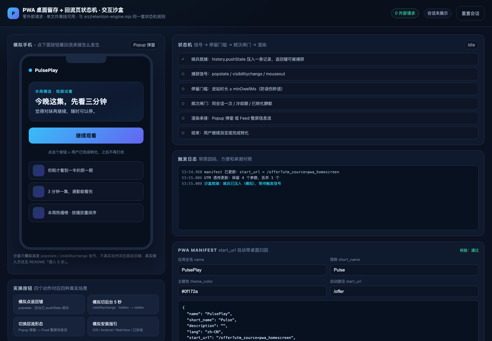
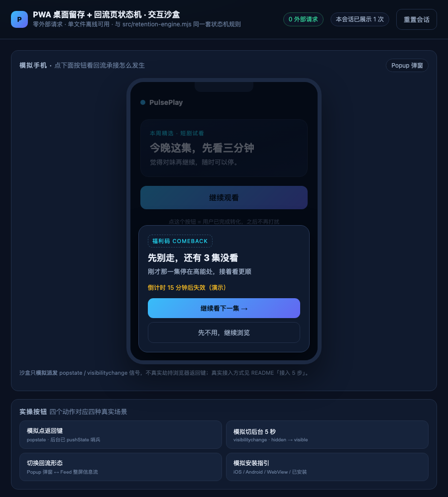
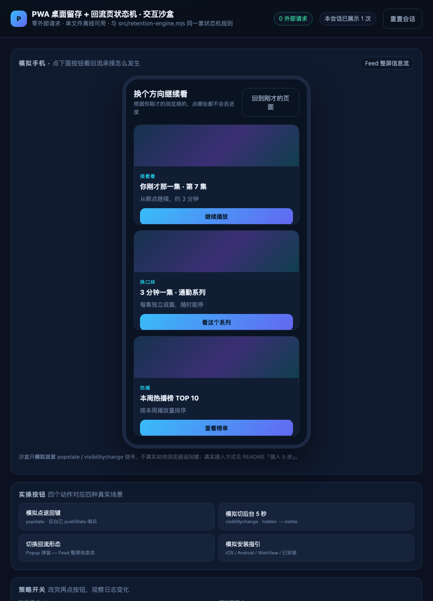

# pwa-return-retention-kit — PWA 桌面留存 + 回流页状态机工具包

> 一个零依赖的开源 Demo 工具包：把「PWA 安装到桌面」和「回流页二次承接」两件事做成可复用的纯函数 + 浏览器运行时 + CLI + 单文件交互沙盒。

> Zero-dependency PWA retention kit: dynamic manifest / service worker generator, back-button (`popstate`) & revisit (`visibilitychange`) return-page state machine with popup or full-screen feed, session frequency lock, conversion suppression and UTM pass-through.

**给谁用**：做投放落地页、内容站、短剧站、电商详情页的前端与增长工程同学。
**不是什么**：不是后台系统、不是投放平台、不是数据看板；仓库里没有任何商业后台代码，也不发任何网络请求。

- ✅ 适合：想让移动端冷流量「别走得太快」的落地页；想把 PWA 安装做进投放链路；想用 Feed 信息流承接返回流量。
- ❌ 不适合：需要服务端人群包 / 用户画像的项目；需要真实数据报表的项目；把回流层当「强制拦截」的项目。



<sub>单文件离线沙盒：左边模拟落地页与四个实操按钮，右边实时显示状态机、触发日志、manifest 与 UTM 透传。0 外部请求。</sub>

```bash
git clone <this-repo> && cd pwa-return-retention-kit
open index.html      # 单文件离线沙盒，0 外部请求
node --test          # 61 个单测，零网络
node cli.mjs --help  # CLI
```

---

## 目录

- [为什么需要「回流页 + PWA 桌面图标」双层留存](#为什么需要回流页--pwa-桌面图标双层留存)
- [三种触发信号与状态机](#三种触发信号与状态机)
- [Popup 弹窗 vs Feed 整屏信息流](#popup-弹窗-vs-feed-整屏信息流)
- [PWA 安装三分支与 Manifest / Service Worker](#pwa-安装三分支与-manifest--service-worker)
- [防打扰铁律](#防打扰铁律)
- [快速开始](#快速开始)
- [CLI](#cli)
- [文件结构](#文件结构)
- [接入 5 步](#接入-5-步)
- [离线沙盒怎么玩](#离线沙盒怎么玩)
- [FAQ](#faq)
- [边界与限制](#边界与限制)
- [相关工具](#相关工具)

---

## 为什么需要「回流页 + PWA 桌面图标」双层留存

投放买的是一次点击，不是一次访问。冷流量落地页的典型情况是：**大部分人（经验上约七成，具体以你自己的数据为准）在第一屏就离开**，而且很多人不是「看完再走」，是「误触返回」「切出去回消息」「被别的 App 拽走」。

普通落地页在这三个瞬间是零承接的：用户已经产生离开动作，页面却还在原地。于是有两个可叠加的抓手：

1. **回流页（Return Page）**：在「用户要离开」的瞬间，用一次低打扰的承接把人留住。形式可以是页面级弹窗（Popup），也可以是整屏信息流（Feed）——把「离开」变成「继续看另一个内容」，而不是硬拦。
2. **PWA 桌面图标（Homescreen）**：把「一次访问」变成「桌面上的一个入口」。从桌面图标启动的会话天然是回访流量，且可以单独归因（`start_url` 自动带 `utm_source=pwa_homescreen`）。

两层的关系不是二选一：**回流页负责当下这一次，PWA 图标负责下一次**。这也正是这个仓库把两者放在一起的原因——它们共用同一套归因参数与同一套「别烦人」的纪律。

> 判断标准很朴素：用户离开时有没有被多留 3 秒、下次还会不会回来。任何以「拦住用户不让走」为手段的实现，都不建议上线。

---

## 三种触发信号与状态机

### 信号从哪来

| 信号 | 浏览器事件 | 适用 | 注意 |
| --- | --- | --- | --- |
| 返回键 / 返回手势 | `history.pushState` + `window.popstate` | 移动端最常见 | 必须留出口，不能把用户困在页面里 |
| 切后台再回来 | `document.visibilitychange`（hidden → visible） | 用户切去回消息 / 看别的 App | 用 `minAwaySeconds` 过滤「刚切走就回来」 |
| 鼠标移出顶部 | `mouseout`（`clientY <= 0` 且无 `relatedTarget`） | 桌面端 | 只作为 back 模式的等价信号 |

### `pushState` + `popstate` 接管返回键的状态机

```text
用户点手机返回键 / 侧滑返回
        │
        ▼
history.pushState 哨兵（页面仍留在原地）
        │
        ▼
window 'popstate' 触发
        │
        ▼
evaluateRetentionTrigger({ signal: 'back', dwellMs, trigger })
        │
        ├─ 未通过：dwell_below_minimum / trigger_mismatch
        │           → 不展示，用户正常离开
        ▼ 通过
shouldFireRetention({ frequency, converted, sessionFired, lastFiredAt, now })
        │
        ├─ 未通过：session_cap_reached / cooldown_active / converted_suppressed
        │           → 静默，不打扰
        ▼ 通过
buildReturnViewModel({ format: 'popup' | 'feed', attribution })
        │
        ▼
渲染回流层；CTA 自动带上 utm_* / fbclid / ttclid
        │
        ├─ 用户点 CTA  → markConverted()：本会话后续全部静默
        └─ 用户点关闭  → 本次不再弹，用户继续浏览或离开
```

`createBackInterceptor` 就是这个状态机的浏览器运行时：它负责压哨兵、监听三个信号、读频次存储、调用纯函数判定，最后把视图模型交给你的渲染层（React / Vue / 原生 DOM 都行）。

### 纯函数一览

| 函数 | 作用 |
| --- | --- |
| `evaluateRetentionTrigger({ signal, trigger, dwellMs, minDwellMs, awayMs, minAwaySeconds })` | 只看「条件是否成立」：信号是否属于当前模式、停留够不够、离开够不够久 |
| `shouldFireRetention({ frequency, converted, sessionFired, lastFiredAt, now, ... })` | 频次闸门：同会话一次 / 冷却期 / 已转化静默 |
| `buildReturnViewModel({ format, campaign, cards, attribution })` | 生成 Popup 或 Feed 的视图模型，CTA 自动透传归因参数 |
| `generatePwaManifest({ name, shortName, startUrl, ... })` | 生成 manifest 对象，`start_url` 自动追加 `utm_source=pwa_homescreen` |
| `generateServiceWorkerScript({ cacheName, version, offlineUrl })` | 生成 Network-First 的 `sw.js` 源码 |
| `detectInstallStrategy(userAgent, standalone)` | 判断 iOS / Android / WebView / 已安装 / 桌面该走哪种安装引导 |

全部是纯函数：不联网、不读全局、不用当前时间，所以 `node --test` 可以完全离线跑。

---

## Popup 弹窗 vs Feed 整屏信息流

两种形态解决的不是同一个问题，别混用：

| 维度 | Popup 弹窗 | Feed 整屏信息流 |
| --- | --- | --- |
| 定位 | 页面级轻承接，一次强提醒 | 整屏接管，把「离开」换成「继续看」 |
| 适合 | 有明确福利钩子 / 下一步动作单一 | 内容站、短剧站、电商多 SKU、问答流 |
| 打扰程度 | 高（遮罩层） | 中（整屏但可关闭，信息密度高） |
| 可点击目标 | 1 个主 CTA | 3–6 张卡片，每张独立 CTA |
| 需要的内容量 | 文案 + 钩子码 + 倒计时 | 至少 3 条真实内容，越多越要克制 |
| 同会话频次 | ≤ 1 次 | ≤ 1 次（且不能和 Popup 叠加） |
| 归因 | 主 CTA 带 `utm_*` / `fbclid` / `ttclid` | 每张卡片 CTA 都带同一组参数 |
| 风险 | 容易变成噪音，必须给关闭按钮 | 卡片内容不真实会反噬信任 |

| 沙盒实拍 |  |  |

```js
// Popup：返回键触发后的一次强承接
buildReturnViewModel({
  format: 'popup',
  campaign: { title: '先别走，还有 3 集没看', hookCode: 'COMEBACK', ctaHref: '/watch/next' },
  attribution: { utm_source: 'facebook', fbclid: 'fb-1' }
});

// Feed：整屏内容流，3–6 张真实卡片，每张单独 CTA
buildReturnViewModel({
  format: 'feed',
  attribution: { utm_source: 'facebook', fbclid: 'fb-1' },
  cards: [
    { title: '你刚才那一集 · 第 7 集', href: '/series/continue?ep=7', ctaLabel: '继续播放' },
    { title: '3 分钟一集 · 通勤系列', href: '/series/commute', ctaLabel: '看这个系列' },
    { title: '本周热播榜 TOP 10', href: '/series/ranking', ctaLabel: '查看榜单' }
  ]
});
```

归因白名单是硬编码的：只透传 `utm_*`、`fbclid`、`ttclid`。邮箱、订单号、手机号这类业务参数会被丢弃，避免被带到下一跳。

---

## PWA 安装三分支与 Manifest / Service Worker

同一个「安装到桌面」的引导，iOS、Android、App 内置浏览器走的是三条完全不同的路：

```text
detectInstallStrategy(userAgent, standalone)
        │
        ├─ standalone = true
        │     → 已从桌面图标启动，不再引导
        ├─ UA 命中 WebView（FBAN / Instagram / 微信 / TikTok / ; wv) ...）
        │     → 引导「在浏览器中打开」，外部浏览器里再走下面分支
        ├─ iOS（iPhone / iPad / iPod）
        │     → Safari 与第三方浏览器都没有 beforeinstallprompt
        │       只能图文引导：分享按钮 → 添加到主屏幕 → 添加
        ├─ Android + Chrome
        │     → 监听 beforeinstallprompt，缓存事件，用户点击时 prompt()
        ├─ Android 其他浏览器
        │     → 菜单里的「安装应用 / 添加到主屏幕」
        └─ 桌面浏览器
              → 地址栏安装图标或应用菜单
```

```js
// 纯前端原型：动态生成 manifest 并挂到 head（生产环境建议服务端按租户返回 /manifest.webmanifest）
const manifest = generatePwaManifest({
  name: 'PulsePlay',
  shortName: 'Pulse',
  themeColor: '#0f172a',
  startUrl: '/offer'
});
// manifest.start_url === '/offer?utm_source=pwa_homescreen'
const link = document.createElement('link');
link.rel = 'manifest';
link.href = `data:application/manifest+json,${encodeURIComponent(JSON.stringify(manifest))}`;
document.head.appendChild(link);
```

`generateServiceWorkerScript()` 生成的是 Network-First 策略：先请求网络，成功就回填缓存；断网时回退缓存，导航请求再回退离线页。同源之外不发请求、不缓存。

安装归因的意义：从桌面图标启动的会话带 `utm_source=pwa_homescreen`，能和浏览器会话分开统计。这是「PWA 到底有没有带来回访」的唯一可验证口径。

---

## 防打扰铁律

这个仓库的默认值就是产品红线，改之前先想清楚：

1. **同会话最多一次**：`frequency: 'once_per_session'` 是默认值，别为了多刷曝光改成 `always`。
2. **已转化永久静默**：用户点过主 CTA / 提交过表单（`markConverted()`）后，不再弹任何回流层。
3. **停留门槛 ≥ 3 秒**：`minDwellMs: 3000`，防止误伤「点进来就走的秒退用户」，也防止把误触当成交互。
4. **离开门槛 ≥ 5 秒**：`minAwaySeconds: 5`，过滤「切出去看一眼立刻回来」。
5. **必须有出口**：弹窗必须有「先不用，继续浏览」；Feed 必须能回到原页面；用户点关闭后本次不再弹。
6. **不伪造紧迫感**：倒计时、库存、名额、钩子码必须是真实数据，示例里的倒计时只是演示占位。
7. **不劫持到底**：用户可以最终离开页面；「返回一次弹一次」是反模式。
8. **不收集数据**：频次状态只写 `sessionStorage` / `localStorage`；不读表单、不读剪贴板、不上传。

---

## 快速开始

```bash
# 1) 看交互沙盒（单文件，离线可用，0 外部请求）
open index.html

# 2) 跑单测：61 个用例，零网络
node --test

# 3) 生成一份 manifest
node cli.mjs manifest --name "PulsePlay" --short "Pulse" --color "#0f172a" --start-url "/offer"

# 4) 在终端里跑一遍回流状态机
node cli.mjs simulate-trigger --trigger both --dwell-ms 4500 --away-sec 12 --already-converted false --json

# 5) 判断某个 UA 该走哪种安装引导
node cli.mjs detect-pwa --ua "Mozilla/5.0 (iPhone; CPU iPhone OS 17_4 like Mac OS X) AppleWebKit/605.1.15 (KHTML, like Gecko) Version/17.4 Mobile/15E148 Safari/604.1" --json
```

Node.js 20+；没有依赖，不需要 `npm install`、不需要构建。

---

## CLI

```
node cli.mjs <command> [options]

命令：
  manifest          生成 manifest.webmanifest（自动追加 utm_source=pwa_homescreen）
  simulate-trigger  跑一遍回流触发状态机：触发条件 → 频次闸门 → 是否展示
  detect-pwa        输入 UA，输出 PWA 安装引导策略
```

### `manifest`

```text
$ node cli.mjs manifest --name "PulsePlay" --short "Pulse" --color "#0f172a" --start-url "/offer"
{
  "name": "PulsePlay",
  "short_name": "Pulse",
  "start_url": "/offer?utm_source=pwa_homescreen",
  "display": "standalone",
  "theme_color": "#0f172a",
  "icons": [ ... 192 / 512 / maskable ... ]
}
校验：通过
```

### `simulate-trigger`

```text
$ node cli.mjs simulate-trigger --trigger both --dwell-ms 4500 --away-sec 12 --already-converted false --json
{
  "trigger": { "matched": true, "reason": "matched" },
  "gate": { "fire": true, "reason": "allowed" },
  "decision": { "fire": true, "reason": "allowed", "showFormat": null }
}
```

加上 `--format popup` 或 `--format feed` 会同时输出视图模型；加 `--utm-source`、`--fbclid` 可以看到归因透传结果。

### `detect-pwa`

```text
$ node cli.mjs detect-pwa --ua "Mozilla/5.0 (iPhone; CPU iPhone OS 17_4 like Mac OS X) ..." --json
{
  "strategy": {
    "environment": "ios-safari",
    "strategy": "ios-share-guide",
    "canPrompt": false,
    "steps": ["点击 Safari 底部的分享按钮", "向下选择「添加到主屏幕」", "确认名称后点「添加」"]
  }
}
```

所有命令都支持 `--json`；`node cli.mjs --help` 看完整参数与退出码（0 成功 / 2 参数错误）。

---

## 文件结构

```text
pwa-return-retention-kit/
├── src/
│   └── retention-engine.mjs     # 纯函数 + 浏览器运行时（零依赖核心）
├── test/
│   └── retention.test.mjs       # 61 个 node:test 用例（零网络）
├── cli.mjs                      # 命令行：manifest / simulate-trigger / detect-pwa
├── index.html                   # 单文件离线交互沙盒（0 外部请求）
├── CONTRIBUTING.md
├── LICENSE                      # MIT
└── .github/
    ├── workflows/ci.yml         # Node 20：语法 + 单测 + CLI 冒烟 + 离线检查
    └── ISSUE_TEMPLATE/bug.yml
```

---

## 接入 5 步

```js
import {
  createBackInterceptor,
  buildReturnViewModel,
  generatePwaManifest
} from './src/retention-engine.mjs';

// 1) 初始化拦截器：触发放任给策略，形态放给 buildModel
const interceptor = createBackInterceptor({
  window,
  document,
  history,
  sessionStorage,
  localStorage,
  policy: {
    trigger: 'both',              // back / revisit / both
    minDwellMs: 3000,
    minAwaySeconds: 5,
    frequency: 'once_per_session',
    suppressAfterConversion: true
  },
  buildModel: ({ attribution }) =>
    buildReturnViewModel({
      format: 'feed',             // 或 'popup'
      attribution,
      cards: [/* 3–6 张真实内容卡片 */]
    }),
  onFire: ({ model }) => renderReturnLayer(model),   // 你的渲染层
  onSkip: ({ reason }) => console.debug('[retention] skip:', reason)
});

// 2) 用户完成主 CTA / 提交表单后，标记转化，之后自动静默
document.querySelector('#main-cta').addEventListener('click', () => {
  interceptor.markConverted();
});

// 3) 生成 PWA manifest（生产环境建议由服务端按租户返回）
const manifest = generatePwaManifest({ name: 'PulsePlay', shortName: 'Pulse', startUrl: '/offer' });

// 4) 生成 sw.js 并注册（构建时写入 /sw.js）
if ('serviceWorker' in navigator) navigator.serviceWorker.register('/sw.js');

// 5) 按 detectInstallStrategy() 的结果，在页面上渲染对应的安装引导
```

渲染层可以直接复用 `index.html` 里的 Popup / Feed 结构；引擎只负责判定与视图模型，不碰 DOM、不绑框架。

---

## 离线沙盒怎么玩

打开 `index.html`（直接双击或用任意静态服务器），左边是模拟的移动端落地页，右边是状态机、触发日志、生成的 manifest 与 UTM 透传结果。

1. **模拟点返回键**：派发 `popstate` 信号，走完整状态机；第一次会展示回流层，之后同会话被频次锁拦截。
2. **模拟切后台 5 秒**：派发 `hidden → visible`，按 `minAwaySeconds` 判断是否算「离开太久」。
3. **切换回流形态**：在 Popup 弹窗与 Feed 整屏信息流之间切换，下次触发就用新形态。
4. **模拟安装指引**：弹层里切换 iOS Safari / Android Chrome / App 内置 WebView，看三种引导文案。
5. **改策略再看**：切换触发模式、频次策略，或点「继续观看」模拟已转化，观察日志里的原因码。

沙盒只**模拟派发**事件，不真实劫持浏览器返回键，所以不会把页面搞乱；真实接入时用 `createBackInterceptor`。

---

## FAQ

**Q：接管返回键会不会让用户退不出去？**
A：不会。默认策略每次捕获后都会重新压哨兵以留住页面，但弹窗始终提供「先不用，继续浏览」；用户关闭后本次不再弹，连续返回仍可离开。不要改成「返回一次弹一次」。

**Q：iOS 能像 Android 一样自动弹安装框吗？**
A：不能。iOS Safari 没有 `beforeinstallprompt`，只能图文引导用户点分享按钮再「添加到主屏幕」。`detectInstallStrategy` 会明确返回 `ios-share-guide`，别指望原生弹窗。

**Q：App 内置浏览器（微信 / TikTok / Facebook）里能装 PWA 吗？**
A：不能。只能先引导用户「在浏览器中打开」，这是 `webview` 分支的策略。强行在内置浏览器里放安装按钮只会浪费点击。

**Q：回流层会影响 SEO 或首屏性能吗？**
A：回流层在客户端按事件触发，不劫持首屏 HTML；引擎本身不发网络请求、不加载外部脚本。PWA manifest 与 SW 也不影响页面收录（注意别把页面本体做成纯客户端渲染）。

**Q：会不会和广告平台像素重复上报？**
A：不会。引擎只做归因参数透传（`utm_*` / `fbclid` / `ttclid`），不注入任何像素、不发请求；像素仍由你自己的埋点层管理。

**Q：频次状态存在哪？会不会上传？**
A：只写 `sessionStorage` / `localStorage`，键名前缀 `rrk:`；不上传、不跨域共享。隐私模式下写失败会自动降级为「不记忆」。

**Q：支持 React / Vue 吗？**
A：支持，但仓库不绑定框架。引擎返回纯对象视图模型，渲染层自己写（`index.html` 是原生 DOM 参考实现）。

**Q：为什么坚持零依赖？**
A：这段代码要贴进投放落地页，体积与可控性优先；单测用 `node:test`，CLI 只用 `node:fs`。依赖越少，越不容易在别人的构建链里出问题。

**Q：数据怎么衡量有没有用？**
A：从桌面图标启动的会话带 `utm_source=pwa_homescreen`，和浏览器会话对比回访；回流页则看「触发 → 点击 CTA → 后续行为」漏斗。别只看展示次数。

---

## 边界与限制

- **这是 Demo 工具包**：状态机、视图模型、Manifest / SW 生成、安装策略识别都是真的，但没有后台、没有人群包、没有 A/B 分流系统。
- **倒计时是演示占位**：真实项目里倒计时、库存、钩子码必须来自真实数据源。
- **动态 `data:` manifest 有浏览器兼容性限制**：生产环境建议服务端按租户动态返回 `/manifest.webmanifest`。
- **Service Worker 只在 HTTPS 或 localhost 可用**：本地用 `http://localhost` 调试没问题。
- **合规自理**：不同地区对弹窗、PWA 安装引导、归因参数有不同要求，上线前请按目标市场规则确认。

---

## 相关工具

- 想直接搭投放落地页、复用这套回流与归因组件：[builder.ipcloak.ai](https://builder.ipcloak.ai?utm_source=github&utm_medium=repo&utm_campaign=pwa-return-retention-kit)（可选，不影响本仓库独立使用）
- 想看「短剧 / 内容站」形态的演示：[culolo.online](https://culolo.online?utm_source=github&utm_medium=repo&utm_campaign=pwa-return-retention-kit)

## Contributing

欢迎 issue 与 PR，先读 [CONTRIBUTING.md](./CONTRIBUTING.md)。特别欢迎：更多安装环境识别（新浏览器 UA）、视图模型无障碍改进、文档修正。

## License

[MIT](./LICENSE) © IpCloak
